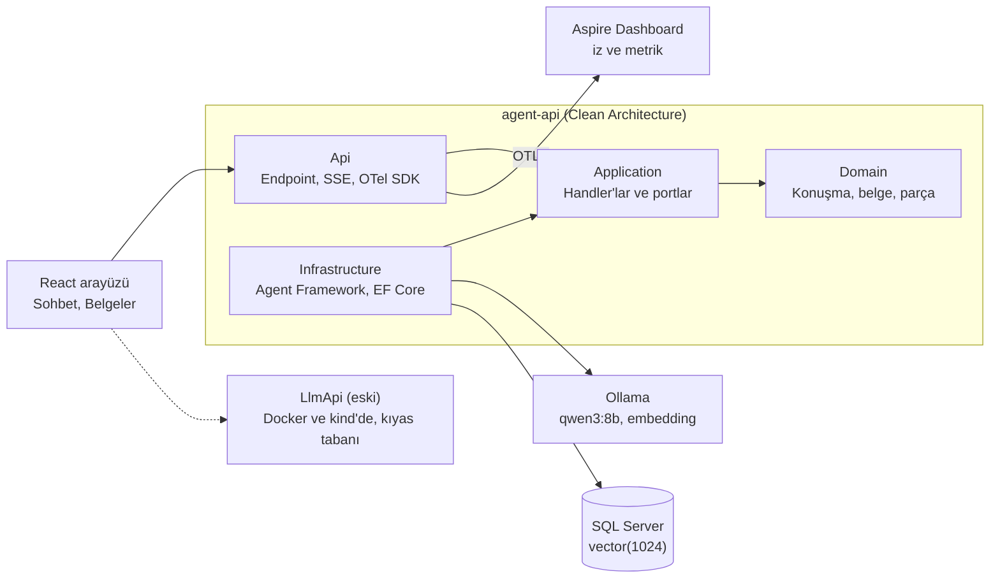
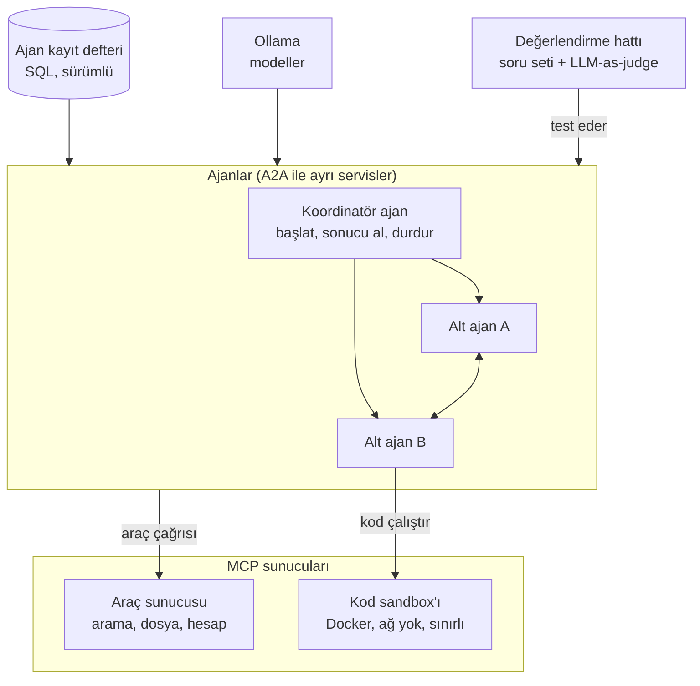
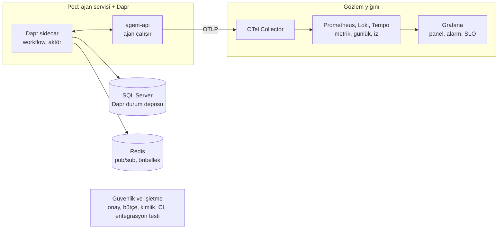
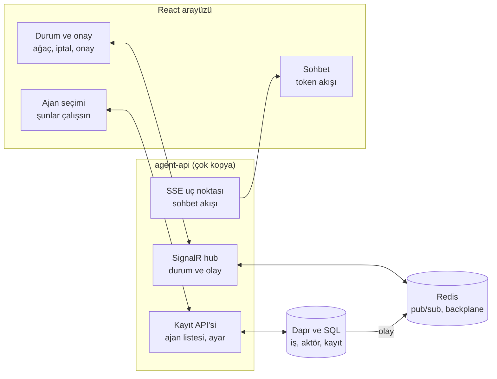

# Mimari diyagramlar (faz faz)

Her faz ayrı bir diyagramdır. Diyagramlar Mermaid ile yazıldı (GitHub, VS Code "Markdown Preview Mermaid Support" eklentisi ve çoğu Markdown görüntüleyicide çizilir).
Kapsam ve gerekçeler için bkz. [ROADMAP.md](ROADMAP.md), çalışan yapının anlatımı için [ARCHITECTURE.md](ARCHITECTURE.md).

Okuma notu: ok yönü "çağırır / veri gönderir" demektir. Faz 2-4 henüz planlıdır; kutulardaki bazı seçimler varsayımdır (ROADMAP'te "(varsayım)" ile işaretli).

## Faz 1: mevcut yapı (tamam)

Bağımlılıklar içe doğrudur: Api ve Infrastructure, Application'a; Application, Domain'e bağlıdır.

## Faz 2: ajan yetenekleri ve birlikte çalışabilirlik

Ajanlar koddan çıkıp kayıt defterindeki kayıtlardan (talimat, model, izinli araç ve beceri, limitler) kurulur.

## Faz 3: işletme ve dayanıklılık

Dapr Workflow uzun işleri yönetir ve ajan bir aktivite olarak çalışır. Aktörler konuşma ve alt ajan görev durumunu tutar.

## Faz 4: durum tabanlı gerçek zamanlı arayüz

Bağlanınca arayüz anlık görüntüyü (snapshot) alır, sonra değişiklikleri izler; bağlantı kopup dönerse kaldığı yerden toparlanır.
